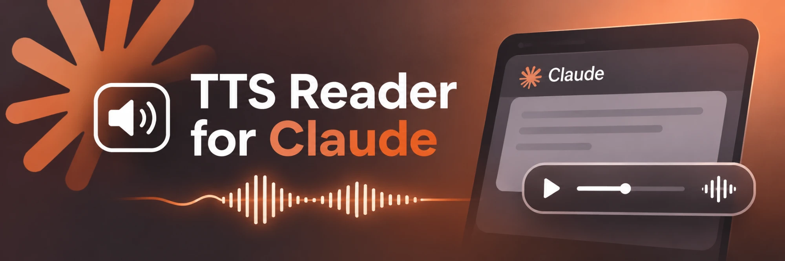

# claudettsedge

A Claude Code plugin that reads Claude's replies out loud using Microsoft Edge's free neural voices ([edge-tts](https://github.com/rany2/edge-tts)).

**Windows only.**

---

## Install

1. Install **Python 3.9+** from [python.org](https://www.python.org/downloads/). Tick **"Add python.exe to PATH"** during setup.
2. In Claude Code, run:

   ```
   /plugin marketplace add NiceName570/claudettsedge
   /plugin install claudettsedge@claudettsedge
   ```

3. Start a **new session**. The first reply takes about 10 seconds while the plugin installs its dependency; after that it's instant.

---

## Commands

| Command | What it does |
| --- | --- |
| `/tts on` | Turn spoken replies on (default) |
| `/tts off` | Turn spoken replies off and stop any audio playing |
| `/tts stop` | Stop current audio without changing the on/off setting |
| `/tts-voice ava` | Use Ava — warm, natural female voice (default) |
| `/tts-voice aria` | Use Aria — clear, confident female voice |
| `/tts-speed +20%` | Speak faster (any `+N%`) |
| `/tts-speed -10%` | Speak slower (any `-N%`) |
| `/tts-speed normal` | Reset to normal speed |

**Stopping audio mid-sentence:** just send a message.

- A normal message stops the audio and Claude answers as usual.
- The message **`ss`** is a pure stop signal: audio stops, Claude only replies "Stopped.", and nothing is spoken.

Settings are saved and kept across sessions.

---

## How it works

```
Claude finishes a reply
        │
        ▼
Stop hook ──► reads the reply ──► filter ──► edge-tts makes an MP3 ──► plays it in the background
                                                                              ▲
You send a message ──► UserPromptSubmit hook ──► kills the player ────────────┘
```

**The filter** decides what is spoken:

1. Each sentence of the reply is checked.
2. A sentence is **skipped** if it contains a number, a file path (`C:\…`, `folder/sub/`, `file.py`), or a URL.
3. Code blocks and tables are never spoken.
4. Markdown (bold, headers, bullets, link syntax) is stripped; words in `backticks` are read normally.
5. If anything with numbers or paths was skipped, it adds once at the end:
   > "Below I've listed the numbers and directories."

**Example**

> The plugin is built. It's in `C:\Projects\claudettsedge`. 3 tests passed. Next we add hooks.

🔊 *"The plugin is built. Next we add hooks. Below I've listed the numbers and directories."*

The written reply on screen is never changed; numbers and paths are always there to read.

### Files

| Path | Purpose |
| --- | --- |
| `hooks/hooks.json` | Registers the two hooks |
| `scripts/hook_speak.py` | Stop hook — finds the last reply and speaks it |
| `scripts/hook_stop.py` | UserPromptSubmit hook — stops audio; handles the `ss` stop signal |
| `scripts/speak.py` | The filter, edge-tts call and Windows audio player |
| `scripts/ttsctl.py` | Backend for the `/tts*` commands |
| `scripts/tts_common.py` | Shared settings, dependency installer, stop logic |
| `commands/*.md` | The slash commands |
| `docs/adr/` | Design decisions |

### Where it keeps things

Everything lives in `%USERPROFILE%\.claude\claudettsedge\`:

| File | Contents |
| --- | --- |
| `config.json` | Your on/off, voice and speed settings |
| `lib\` | Private copy of edge-tts and its packages |
| `last.mp3` | The most recent spoken audio |
| `player.pid` | ID of the player while it's talking |

---

## Dependencies

| Needed | How you get it |
| --- | --- |
| Windows 10 / 11 | — |
| Python 3.9+ | You install it ([python.org](https://www.python.org/downloads/)) |
| [edge-tts](https://pypi.org/project/edge-tts/) (and its packages, e.g. aiohttp) | **Installed automatically** on first use into `%USERPROFILE%\.claude\claudettsedge\lib`, never into your global Python |
| Windows PowerShell | Built into Windows; used to play audio |
| Internet connection | edge-tts creates the audio on Microsoft's servers |

The hooks run `python`, and fall back to the `py -3` launcher if `python` isn't found.

---

## Privacy

To create the audio, the **filtered sentences** are sent to Microsoft's online Edge text-to-speech service. Code, paths and numbers are filtered out and never sent. Turn it off any time with `/tts off`.

---

## Troubleshooting

| Problem | Fix |
| --- | --- |
| **Nothing is spoken at all** | Start a new session after installing. Run `/tts on`. Check `/plugin` lists `claudettsedge` as enabled. |
| **No sound, but no errors** | Check Windows volume, mute, and the output device (headphones vs speakers). |
| **"could not install edge-tts"** | Run `python -m pip install edge-tts` once yourself, then start a new session. |
| **`python` is not recognized** | Reinstall Python with "Add to PATH" ticked, or make sure the `py` launcher is installed. |
| **Typing `python` opens the Microsoft Store** | Settings → Apps → Advanced app settings → App execution aliases → turn off the `python.exe` aliases, then install Python from python.org. |
| **First reply is silent / slow** | Normal on first use while edge-tts installs (~10 s). If it times out, the next reply will speak. |
| **It keeps saying "Below I've listed the numbers and directories"** | That reply had sentences with numbers or paths; they're on screen. |
| **Audio overlaps or won't stop** | Send any message. If stuck, delete `%USERPROFILE%\.claude\claudettsedge\player.pid` and close stray `powershell.exe` processes in Task Manager. |
| **Voice won't change** | Only `ava` and `aria` are supported. Run `/tts-voice ava`. |
| **Reset everything** | Delete `%USERPROFILE%\.claude\claudettsedge\` — defaults return and edge-tts reinstalls on next use. |

---

## Uninstall

```
/plugin uninstall claudettsedge@claudettsedge
/plugin marketplace remove claudettsedge
```

Then delete `%USERPROFILE%\.claude\claudettsedge\` to remove settings and the private edge-tts install.

---

## License

MIT — see [LICENSE](LICENSE).
